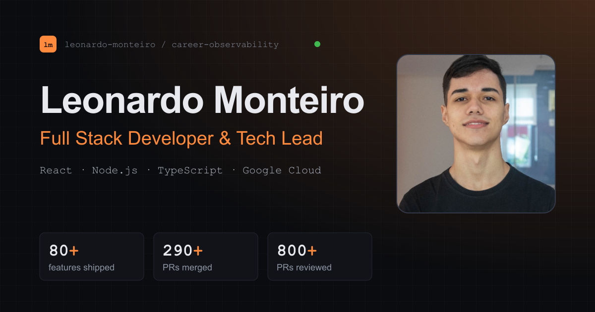

I'm a full-stack developer and tech lead at Clinicorp, working on the financial module of a healthcare SaaS used by 30,000+ dental clinics. I lead a team of six developers and still write a lot of the code: TypeScript, React and Node.js on Google Cloud.

These days I'm moving that module off a legacy JavaScript codebase into a TypeScript micro-frontend. On the side, I'm building [MoldAI](https://github.com/LeonardoMonteiroo/moldai).

[Portfolio](https://leonardomonteiroo.github.io/personal-portfolio/) · [LinkedIn](https://www.linkedin.com/in/leonardo-monteiroo) · leonardo.monteiro599@outlook.com

## Side projects

**[MoldAI](https://github.com/LeonardoMonteiroo/moldai)**: describe a garment in a chat and get a 2D sewing pattern, graded in sizes and ready to export as DXF, PLT or PDF. The model only proposes the garment; the server validates it and drafts the pieces.
Next.js · PostgreSQL · Prisma · Redis · Anthropic API · Stripe

**[Fashion lookbook](https://leonardomonteiroo.github.io/landing-octa-2026/)**: animated site for a fashion collection, built from the designer's PDF. Scripts extract every image and vector, so nothing is edited by hand.
Astro · Tailwind CSS · GSAP

**[voting-api](https://github.com/LeonardoMonteiroo/voting-api)**: polls with live results over WebSocket.
Fastify · Prisma · PostgreSQL · Redis · Docker

**[transactions-api](https://github.com/LeonardoMonteiroo/transactions-api)**: financial transactions API with cookie sessions and end-to-end tests.
Fastify · Knex · Zod · Vitest

## From work

Case studies on my portfolio:

- [Migrating a legacy financial module to a TypeScript micro-frontend](https://leonardomonteiroo.github.io/personal-portfolio/cases/financial-micro-frontend/)
- [Running a financial module in production: integrations and observability](https://leonardomonteiroo.github.io/personal-portfolio/cases/observability-and-production-support/)
- [Raising engineering quality: tests, reviews and AI-assisted workflows](https://leonardomonteiroo.github.io/personal-portfolio/cases/engineering-quality-and-leadership/)

## Toolbox

TypeScript · React · Node.js · Fastify · Next.js · PostgreSQL · Prisma · Redis · Google Cloud (Datastore, Pub/Sub, BigQuery) · Jest · Vitest · Grafana · Docker

I speak Portuguese, English and some LIBRAS (Brazilian Sign Language).
